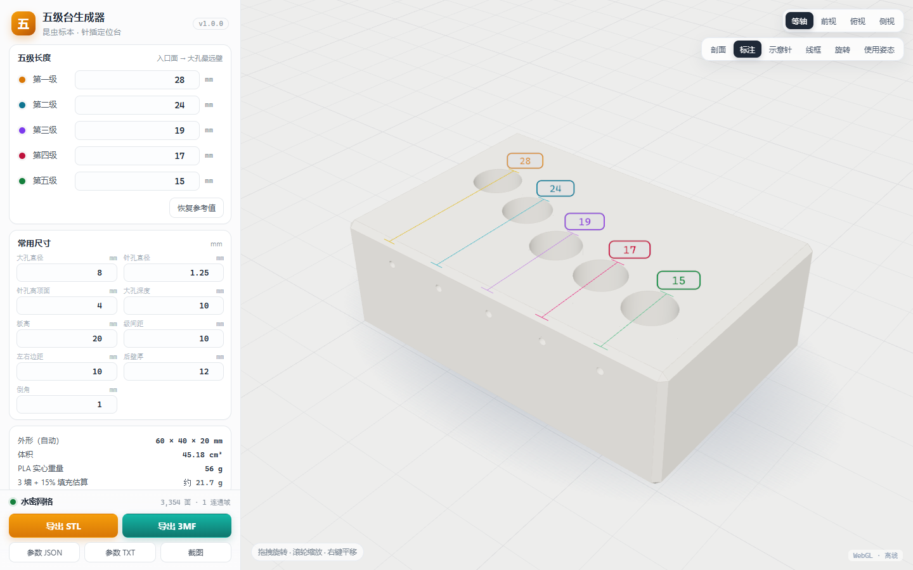
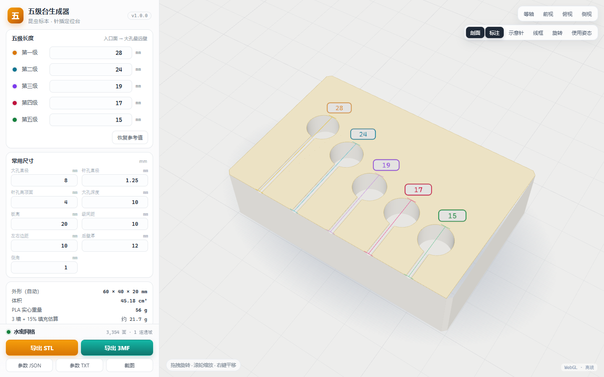
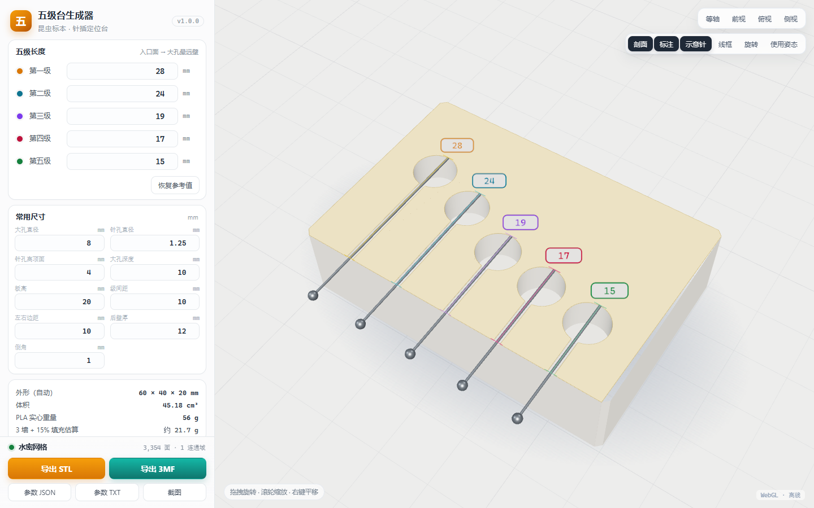

# 五级台生成器 · 昆虫标本针插定位台

**双击即用的单文件网页生成器**：填 5 个长度 → 实时 3D 预览 → 导出可直接进 Bambu Studio 的 STL / 3MF。
离线运行（three.js 已内联），不联网、不上传、不需要 Node / Python。

**在线使用（GitHub Pages）**：<https://tianqiqwq.github.io/five-stage-gen/>



```
双击 五级台生成器.html   →   改 5 个长度   →   导出 STL / 3MF
```

---

## 1. 它是做什么的

昆虫针插标本时，虫体和标签在针上的高度需要统一。这个「五级台」是一个定位块：

- 主体 60 × 40 × 20 mm 的倒角长方体；
- 顶面 5 个大圆孔（Ø8，深 10，平底），每个孔的前侧有一条细长针孔（Ø1.25）通到孔里；
- **针尖从前立面插进针孔、在孔内顶到大圆孔的最远壁**；虫体（或标签）贴住入口面，于是“虫体/标签 → 针尖”的距离就是该级的长度；
- 5 个长度分别对应 5 个高度档位，按你的尺寸表定制。

本工具把上面这套几何**参数化**：改长度或常用尺寸，网格、标注、体积重量、导出文件全部实时更新。

### 长度定义（本工具的核心）

```
前端面（针孔入口 y=0）
   │
   │   Ø1.25 针孔（长度 = L − 大孔直径）
   ▼
  ╭──────────╮
  │  Ø8 大孔  │ ← 针尖顶到最远的这面壁
  ╰──────────╯
   └──────────── L ────────────┘    （入口面 → 大孔最远壁）
```

- 大孔圆心距入口面：`y_c = L − R`（R = 大孔半径）；
- 针孔直线段长度：`L − 大孔直径`；
- 5 级默认值：**28 / 24 / 19 / 17 / 15 mm**。

> 你提供的文件名是 `28 24 29 17 15`，但模型实测第 3 级是 **19**（大孔最远壁到入口面 19.00 mm），本工具与你的消息一致按 **19** 处理；文件名应为笔误。

---

## 2. 参考模型核对（来自 STEP + 3MF 交叉验证）

| 项目 | 实测 |
|---|---|
| 主体 | 60 × 40 × 20 mm，12 条棱 1 mm × 45° 倒角 |
| 5 级 X 位置 | 10 / 20 / 30 / 40 / 50（级距 10，边距 10） |
| 大孔 | Ø8、顶面开口、深 10、平底（第 5 级 Ø7.5） |
| 针孔 | Ø1.25、前端面开口、轴心距顶面 4（第 5 级 Ø2） |
| 长度 | 28 / 24 / 19 / 17 / 15（入口面 → 大孔最远壁） |
| 后壁 | 12 mm |
| STEP 面数 | 41 面 = 31 平面 + 10 圆柱面，15 个内环，1 个闭合实体 |
| 3MF 体积 / 顶面面积 | 45221.89 mm³ / 1958.88 mm² |

**黄金回归**：用本工具的逐级孔径配置复刻参考件，得到 **45222.39 mm³**（与 3MF 相差 **+0.0011%**）、包围盒 60×40×20、顶面面积 1958.9 mm²，5 个孔位/半径/长度全部对齐。

> 按你的选择，界面默认把第 5 级也统一成 Ø8 / Ø1.25（因此默认件与参考件第 5 级差 0.25 mm 圆心、半径差 0.25 mm）。若想复刻参考件第 5 级，可用调试 hash 指定逐级孔径，见 §7。

---

## 3. 界面与操作

| 区域 | 说明 |
|---|---|
| 左侧「五级长度」 | 5 个核心长度，0.1 mm 步进；「恢复参考值」一键回到 28/24/19/17/15 |
| 左侧「常用尺寸」 | 大孔直径、针孔直径、针孔离顶面、大孔深度、板高、级距、左右边距、后壁厚、倒角 |
| 外形（自动） | `W = 2×边距 + 4×级距`，`D = max(L) + 后壁厚`，`H = 板高` |
| 底部状态条 | 水密 / 面数 / 连通域；参数不合法时显示红色错误并禁用导出 |
| 右上视图 | 等轴 / 前视 / 俯视 / 侧视 |
| 右上开关 | **剖面**（关键）、标注、示意针、线框、旋转、使用姿态 |
| 底部按钮 | 导出 STL、导出 3MF、参数 JSON、参数 TXT、截图 |

**剖面视图**是最直观的检查方式：在针孔轴平面切开，封盖上直接看到 5 个「细长针孔 + 大圆孔」的钥匙孔形状和各自的长度标注。

| 剖面 | 剖面 + 示意针 |
|---|---|
|  |  |

快捷键：`1–4` 视图，`5` 剖面，`D` 标注，`P` 示意针，`W` 线框，`A` 旋转，`U` 使用姿态，`R` 复位。

---

## 4. 参数（默认值 / 说明）

| 参数 | 默认 | 说明 |
|---|---:|---|
| 五级长度 L | 28, 24, 19, 17, 15 | 入口面 → 大孔最远壁 |
| 大孔直径 | 8 | 5 级统一 |
| 针孔直径 | 1.25 | 5 级统一 |
| 针孔离顶面 | 4 | 针孔轴心到顶面 |
| 大孔深度 | 10 | 从顶面往下 |
| 板高 | 20 | 底面到顶面 |
| 级间距 | 10 | 相邻大孔圆心距 |
| 左右边距 | 10 | 第一/第五级圆心到侧边 |
| 后壁厚 | 12 | 最长一级大孔最远壁到后立面 |
| 倒角 | 1 | 12 条棱 45° 倒角；0 = 直角 |

自动校验（会阻止导出）：`L ≥ 大孔直径 + 1`、孔底留 ≥2 mm、针孔在板厚内、级间壁厚 ≥1.5 mm、大孔不切倒角 等。
软警告（不阻止）：针孔 <0.8 mm（FDM 需通针）、级间壁厚偏薄、外形超过 256 mm 热床。

---

## 5. 导出说明

| 文件 | 内容 |
|---|---|
| `五级台_<L1>-<L2>-<L3>-<L4>-<L5>.stl` | 二进制 STL，**XY 居中、底面 z=0**，可直接切片 |
| 同名 `.3mf` | 标准 3MF（unit=mm），网格居中 + build transform `(128,128,0)`，Bambu Studio 打开即落在热床中心 |
| 同名 `.json` / `.txt` | 全部参数 + 派生外形 + 体积/面积/包围盒/水密结果，便于归档 |
| `*_视图.png` | 当前画布截图 |

**打印建议**：大孔朝上平放（与参考 3MF 一致），免支撑；0.2 mm 层高、3 层墙、15% 填充；PLA 实心约 **56 g**，按 15% 填充实打印约 **22 g**。Ø1.25 横向针孔建议切片时设 0.1 mm 孔补偿，打印后用针灸针/通针过一遍。

---

## 6. 验收结果（本机实测）

| 项目 | 结果 |
|---|---|
| 几何/导出单元测试 | **90 / 90 通过**（水密、无退化、长度射线实测、孔径、面积、体积、黄金基准、STL/3MF 回读、边界参数） |
| 单文件静态验收 | **22 / 22 通过**（无外链、无 fetch/XHR、语法、体积 711 KiB） |
| headless Chrome 端到端 | **60 / 60 通过**（启动、默认几何、STL/3MF 字节校验、真实下载 3MF/JSON/TXT/PNG、DOM 输入联动、非法参数、剖面/示意针/姿态/视图、390×844 移动端布局与工具栏、零 console error） |
| 默认网格 | 3,354 面 / 1,669 顶点 / 水密 / 45.18 cm³ / 60×40×20 |
| 黄金基准 | 45,222.39 mm³ vs 参考 45,221.89 mm³（+0.0011%） |
| 样例文件 | `samples/五级台_28-24-19-17-15.stl`（164 KiB）/ `.3mf`（200 KiB） |

复现（需要 Node 22+；`tools/e2e.mjs` 用到 Node 内置 WebSocket）：

```powershell
cd five-stage-gen
node tools/test-geometry.mjs
node tools/build.mjs
node tools/verify-built.mjs --html 五级台生成器.html
node tools/e2e.mjs
node tools/make-samples.mjs
```

---

## 7. 调试 / 分享链接

工具会把当前参数写进 URL hash，复制链接即可还原：

```
五级台生成器.html#L=28,24,19,17,15&bore=8&pin=1.25&drop=4&depth=10&h=20&pitch=10&margin=10&rear=12&chamfer=1&view=section&section=1&dims=1
```

- `L` / `bore` / `pin` 可写 1 个值（统一）或 5 个逗号分隔值（逐级）——例如复刻参考件：`bore=8,8,8,8,7.5&pin=1.25,1.25,1.25,1.25,2`。
- `view=iso|front|top|side|section`；`section/dims/pins/wire/auto` 取 0/1；`pose=print|use`；`ui=0` 隐藏界面；`freeze=1` 跳过入场动画（截图用）。

浏览器控制台可用 `window.__FIVE_STAGE__`：`getParams() / setParams({L:[...]}) / getAudit() / exportBytes('stl'|'3mf') / screenshot()`。

---

## 8. 目录

```text
five-stage-gen/
├─ 五级台生成器.html          ← 主交付物：单文件离线网页（双击打开）
├─ index.html                ← GitHub Pages 入口（与五级台生成器.html 同内容，构建时镜像）
├─ LICENSE                   ← MIT
├─ src/index.html             ← 页面外壳 + CSS + UI 结构
├─ src/app/
│  ├─ 00-core.js              ← 参数、派生、校验、URL 状态
│  ├─ 10-geometry.js          ← 解析法精确网格（倒角体/大孔/针孔/交线）+ 审计 + 剖面
│  ├─ 20-export.js            ← 二进制 STL、3MF（自写 ZIP）、参数导出
│  ├─ 30-scene.js             ← 3D 场景、视图、剖面封盖、标注、示意针、姿态
│  ├─ 40-ui.js                ← 面板、校验提示、导出、快捷键、响应式
│  └─ 50-main.js              ← 启动与 window.__FIVE_STAGE__
├─ vendor/                    ← three.js r147 + OrbitControls（MIT）
├─ tools/                     ← build / verify / test / e2e / shot / make-samples
├─ samples/                   ← 默认尺寸 STL / 3MF / 参数 TXT
├─ preview/                   ← 7 张最终截图
└─ README.md
```

---

## 9. 已知边界

- 本版**不导出 STEP**（你选择的是单文件网页版）；需要真 STEP / .f3d 时可后续加一个 Fusion 360 脚本，几何参数已完全确定。
- 界面按你的选择只暴露「统一孔径」；逐级孔径仅在 URL hash / API 层支持（用于复刻参考件）。
- 级数固定 5 级（内部数组结构可扩展）。
- 需要支持 WebGL 的浏览器（Chrome / Edge / Safari 均可）；`file://` 双击即可，无需本地服务器。
- 3MF 为标准模型 3MF，不含切片参数；实际打印前请在 Bambu Studio 里确认摆放与孔补偿。

## 10. 许可

- 本项目代码采用 **MIT License**，见 [`LICENSE`](LICENSE)。
- three.js r147：MIT，见 `vendor/THREE-LICENSE.txt`。
- 参考模型数据归你所有；仓库内的 3MF / STL 仅为你自己的模型导出件。
